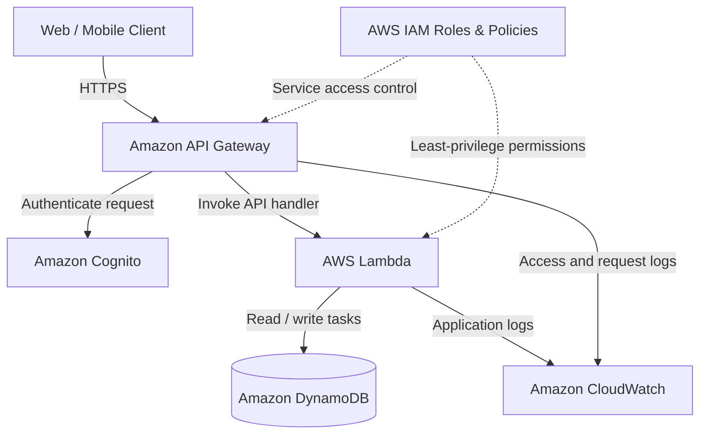

# SWYNEX – Cloud Architecture Outline

## Project: Cloud-Based Task Management API
**Cloud provider:** Amazon Web Services (AWS)  
**Architecture style:** Serverless, API-driven architecture  
**Purpose:** Demonstrate compute, storage, networking, identity, and basic security for a simple web/API workload.

---

## 1. Project Overview

This design describes a cloud-hosted Task Management API. A client application (web or mobile) sends HTTPS requests to the API. The API authenticates users, invokes serverless application code, and stores task records in a managed NoSQL database.

The design uses managed AWS services to reduce server administration, scale with demand, and keep the architecture simple.

## 2. Architecture Diagram

**Request flow:**
1. The client sends an HTTPS request to Amazon API Gateway.
2. Amazon Cognito validates the user's identity through an API authorizer.
3. API Gateway routes the authorized request to the relevant AWS Lambda function.
4. Lambda performs the application logic and reads or writes task data in DynamoDB.
5. API Gateway and Lambda send operational logs and metrics to CloudWatch.
6. IAM roles and policies control which AWS resources each service can access.

## 3. Core Cloud Components

### A. Compute – AWS Lambda
- Runs the API's business logic without managing virtual machines.
- Can use separate functions for creating, viewing, updating, and deleting tasks.
- Automatically scales based on incoming requests.
- Uses an execution role with only the permissions required by the function.

### B. Storage – Amazon DynamoDB
- Stores task records in a managed NoSQL table.
- Example task attributes: `userId`, `taskId`, `title`, `status`, and `createdAt`.
- Supports low-latency key-value access and automatic scaling options.
- Encryption at rest is enabled by default for DynamoDB.

### C. Networking – Amazon API Gateway
- Provides HTTPS endpoints for the application.
- Routes requests to the appropriate Lambda function.
- Supports throttling, request validation, and access logging.
- Can use a Cognito authorizer to protect authenticated endpoints.
- A custom domain and Amazon Route 53 DNS can be added for a production deployment.

### D. Identity and Access Management
- **Amazon Cognito:** user sign-up, sign-in, and token-based authentication.
- **AWS IAM:** service-to-service permissions through roles and policies.
- Apply least privilege: Lambda should access only the required DynamoDB table and log resources.
- Do not store AWS credentials or secrets in application source code.

### E. Monitoring – Amazon CloudWatch
- Collects Lambda logs, API Gateway access logs, and metrics.
- Supports alarms for errors, latency, and throttling.
- Helps troubleshoot failures and monitor workload health.

## 4. High-Level Architecture Decisions

| Area | Design choice | Reason |
|---|---|---|
| Compute | AWS Lambda | No server management; scales with requests |
| Data storage | DynamoDB | Managed NoSQL storage for task records |
| API/network entry | API Gateway over HTTPS | Managed API endpoint and request routing |
| Authentication | Amazon Cognito | Managed user identity and token validation |
| Permissions | AWS IAM roles | Fine-grained service access |
| Monitoring | CloudWatch | Centralized logs, metrics, and alarms |

## 5. Security Considerations

1. Require HTTPS for client-to-API communication.
2. Require valid Cognito access tokens for protected API operations.
3. Apply least-privilege IAM permissions to Lambda execution roles.
4. Enable encryption at rest for stored data and use TLS in transit.
5. Avoid placing passwords, access keys, or tokens in source code.
6. Enable API and Lambda logging, while avoiding sensitive data in logs.
7. Configure throttling and monitoring to help detect abnormal request patterns.
8. Back up or enable point-in-time recovery for important production data.

## 6. Scalability, Reliability, and Cost

- **Scalability:** Lambda and API Gateway scale with request volume; DynamoDB supports on-demand capacity.
- **Reliability:** managed AWS services reduce infrastructure maintenance. Configure DynamoDB point-in-time recovery for important data.
- **Cost:** serverless services generally charge based on usage. Set AWS Budgets and billing alerts before experimenting.
- **Limits:** service quotas, Lambda timeout and concurrency, API throttling, and DynamoDB capacity should be reviewed before production use.

## 7. Example API Endpoints

| Method | Endpoint | Purpose |
|---|---|---|
| POST | `/tasks` | Create a task |
| GET | `/tasks` | List the authenticated user's tasks |
| GET | `/tasks/{taskId}` | Retrieve one task |
| PUT | `/tasks/{taskId}` | Update a task |
| DELETE | `/tasks/{taskId}` | Delete a task |

These endpoints are part of the proposed design; this repository documents the architecture and does not deploy live AWS resources.

## 8. Deployment Outline

1. Create a DynamoDB table with a suitable partition and sort key design.
2. Create Lambda functions for the task operations.
3. Create an IAM execution role with least-privilege DynamoDB and CloudWatch permissions.
4. Configure API Gateway routes and integrations to Lambda.
5. Configure a Cognito user pool and an API Gateway authorizer.
6. Enable API Gateway access logs and Lambda logging in CloudWatch.
7. Test authenticated requests and verify that users can access only their own task records.
8. Configure a budget and clean up test resources when finished.

## 9. Conclusion

This architecture provides a simple, scalable, and maintainable foundation for a cloud-based API. It separates API access, application compute, data storage, identity, and monitoring into managed AWS services. The design can be extended with a frontend hosted on Amazon S3 and CloudFront, custom DNS through Route 53, and additional security controls as requirements grow.

---

## 10. References

- [AWS Lambda documentation](https://docs.aws.amazon.com/lambda/)
- [Amazon API Gateway documentation](https://docs.aws.amazon.com/apigateway/)
- [Amazon DynamoDB documentation](https://docs.aws.amazon.com/dynamodb/)
- [Amazon Cognito documentation](https://docs.aws.amazon.com/cognito/)
- [AWS Identity and Access Management documentation](https://docs.aws.amazon.com/iam/)
- [Amazon CloudWatch documentation](https://docs.aws.amazon.com/cloudwatch/)

**Note:** This is a conceptual architecture outline for the SWYNEX task. It does not claim that AWS resources have been created or deployed.
